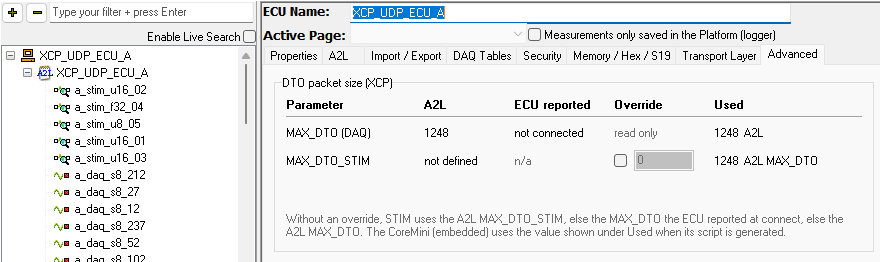

# MEP Setup - Advanced

The [MEP Setup](./) Advanced tab (Figure 1) shows how large the XCP data packets (DTOs) to and from the selected ECU can be, and where each limit comes from. It also lets you override the size of the STIM packets that the [XCP STIM](../../../main-menu-scripting-and-automation/function-blocks/function-blocks-types/script-type-function-block-commands/script-type-function-block-command-xcp-stim.md) command sends. The tab is shown for XCP ECUs only; CCP has no STIM.

### The Two Packet Sizes

XCP has two limits for data packets:

* **MAX\_DTO** limits DAQ packets, which carry measurements from the ECU to Vehicle Spy.
* **MAX\_DTO\_STIM** limits STIM packets, which carry values from Vehicle Spy to the ECU. It is optional. An A2L file that does not define it leaves STIM packets limited by **MAX\_DTO**.

The size of a STIM packet bounds how many data bytes one STIM ODT can carry: the packet size minus its identification field.

### The Table

Each row shows one limit. The columns show where a value can come from, and which one Vehicle Spy uses (Table 1).

**Table 1: MEP Setup Advanced Columns**

| Column       | MAX\_DTO (DAQ)                                                                 | MAX\_DTO\_STIM                                                                                     |
| ------------ | ------------------------------------------------------------------------------ | -------------------------------------------------------------------------------------------------- |
| A2L          | The value in the ECU's A2L file.                                               | The value in the ECU's A2L file, or **not defined**.                                               |
| ECU reported | The value the ECU reported when Vehicle Spy connected, or **not connected**.  | **n/a**. An ECU reports only MAX\_DTO when Vehicle Spy connects.                                   |
| Override     | **read only**.                                                                 | Check the box and enter a value to override the size of STIM packets.                             |
| Used         | The value Vehicle Spy uses for DAQ, and where it comes from.                   | The value Vehicle Spy uses for STIM, and where it comes from.                                      |

For STIM, Vehicle Spy uses the first of these that is set:

1. the **Override**;
2. the A2L file's **MAX\_DTO\_STIM**;
3. the **MAX\_DTO** the ECU reported when Vehicle Spy connected;
4. the A2L file's **MAX\_DTO**.

A CoreMini uses the value shown under **Used** at the time its script is generated.

### XCP on CAN

On CAN, the CAN frame also limits the packet:

* **Classical CAN, or CAN FD without Force DLC to Max:** at most 8 bytes. If the value is larger, **Used** shows 8 and **VSpy CAN limit**, and the tab shows **VSpy caps CAN to max 8 bytes.**
* **CAN FD:** when the request's **CAN FD** and **Force DLC to Max** are checked on the **Transport Layer** tab, a frame can carry up to its **Max DLC**. If the value is larger, **Used** shows the Max DLC and **VSpy CAN FD limit**.

### Overriding MAX\_DTO\_STIM

The override is for cases where the A2L file does not describe the ECU's STIM limit correctly. When you check the box, it starts at the value Vehicle Spy is using. Enter a whole number from 8 to 65535. Clear the box to remove the override.

* If the value is not valid, the tab shows a message in red and keeps using the previous value.
* If the value is larger than the **MAX\_DTO** the ECU reported, the tab warns that the ECU may reject larger STIM packets. Vehicle Spy still uses the value.
* The override is saved with the ECU: in the setup for an ECU added for calibration, or in the platform for an ECU added for measurement and logging.
* The override cannot be changed while Vehicle Spy is online, because the STIM ODTs are set up when it goes online.

If an existing STIM ODT no longer fits after you change the limit, compiling a CoreMini fails, and online Vehicle Spy does not start MEP for that ECU. See [XCP STIM](../../../main-menu-scripting-and-automation/function-blocks/function-blocks-types/script-type-function-block-commands/script-type-function-block-command-xcp-stim.md#how-many-bytes-an-odt-can-carry).
