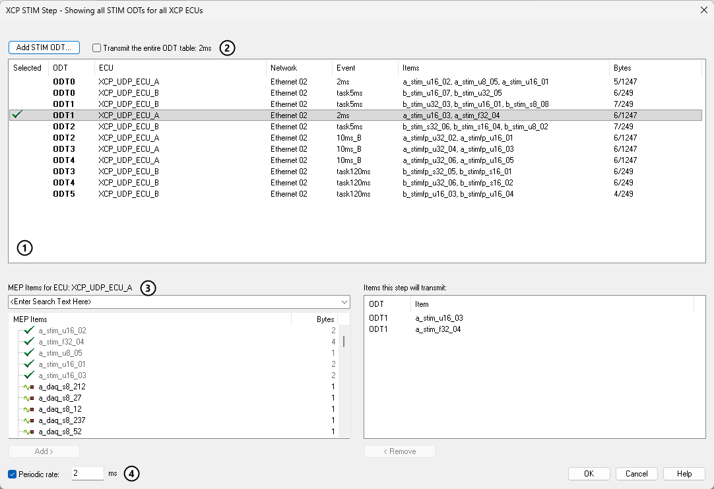
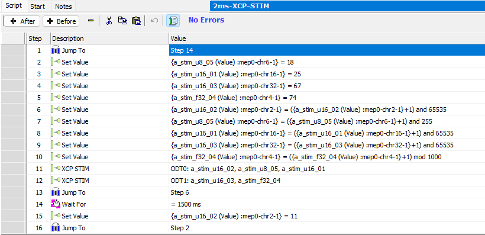

# Script Type Function Block Command: XCP STIM

### Command Description

Use this command to send values to an ECU with XCP stimulation (STIM).

XCP can stream data in both directions, synchronized to the ECU's own events, such as a 2 ms task. With DAQ (data acquisition), the ECU sends measurements to Vehicle Spy. With STIM, Vehicle Spy sends values to the ECU, and the ECU writes them into its memory when the event occurs. STIM is used for bypassing and stimulating ECU software: Vehicle Spy supplies the values the ECU would otherwise calculate itself.

The values are sent in **STIM ODTs**. A STIM ODT (Object Descriptor Table) is a group of [MEP items](../../../../main-menu-measurement/mep-xcp-ccp-memory-edit-protocol/) that travel together in one STIM packet, bound to one of the ECU's events. Set the values with [Set Value](script-type-function-block-command-set-value.md) commands; the **XCP STIM** command then sends them to the ECU.

The **XCP STIM** command works:

* with XCP on UDP, XCP on TCP and XCP on CAN, including CAN FD. XCP on FlexRay is not supported, and CCP has no STIM.
* online in Vehicle Spy (with MEP), and in a [CoreMini](../../../../main-menu-tools/utilities-coremini-console/) script running on the device.
* with or without VehicleScape DAQ channels in the same setup.

### Value Field Parameters

Double-click the **Value** field of the **XCP STIM** command to open the setup dialog (Figure 1). The dialog shows every STIM ODT of every XCP ECU in the setup. The ODTs are saved with the setup and shared by all **XCP STIM** commands, so editing an ODT here changes it for every command that sends it.

 **STIM ODTs.** Each row is one STIM ODT, with its **ECU**, **Network**, **Event** and **Items**, and the **Bytes** it uses out of the most it can carry. Click the row of the ODT this command sends.

* **Add STIM ODT...** creates a new ODT. It offers the ECUs that use XCP on UDP, XCP on TCP or XCP on CAN. If there is more than one, Vehicle Spy asks which one.
* If an ECU is changed to XCP on FlexRay or CCP after its ODTs were set up, the dialog no longer lists its ODTs. While they have items, compiling a CoreMini fails with an error that names the ODT, and online Vehicle Spy does not start MEP for an XCP on FlexRay ECU. To keep the new protocol, change the ECU back, remove the items from its ODTs, and then change it again.
* **Event** is the ECU's event channel: the ECU applies the values it receives when this event occurs. Right-click a row and choose **Set Event** to pick one of the ECU's enabled events. A new ODT starts with the event of the selected row, when that row is for the same ECU. An ODT without an event shows **(not set)** in red, and items cannot be added to it.
* The check mark in the **Selected** column shows which ODTs this command sends.

 **Transmit the entire ODT table.** When this is checked, the command sends every ODT of the selected ODT's ECU that uses the same event. When it is not checked, the command sends only the selected ODT.

 **MEP Items.** The MEP items of the selected ODT's ECU, with their size in bytes. Type in the box to filter the list.

* **Add >**, or a double-click, adds the selected item to the selected ODT. An item can be in only one ODT; items already in an ODT are grayed out and marked with a check mark. When **Add >** is unavailable, hold the mouse over it to see why: no ODT or no MEP item is selected, the ODT has no event, the item is already in an ODT, or the item does not fit in the ODT's remaining bytes.
* **< Remove** takes the selected item out of its ODT.
* **Items this step will transmit** lists, by ODT, the items this command sends.

 **Periodic rate.** When this is checked, the command sends at most once every **N** milliseconds. Each time the script reaches the command, it waits until **N** milliseconds have passed since its last send. This keeps a looping script at a steady rate, both online and in a CoreMini. When it is not checked, the command sends every time the script reaches it.

**Warning:** In a loop, use a periodic rate, or a wait somewhere in the loop. Without one, the command sends as fast as Vehicle Spy or the CoreMini can run the script. On CAN, and above all on CAN FD with 64-byte frames, this can fill the bus. Frames with a lower priority then cannot get through, and these can include the ECU's responses to XCP commands. A CoreMini that gets no response treats the ECU as lost and sets it up again, so its STIM stops and starts.

### How Many Bytes an ODT Can Carry

A STIM ODT fits in one STIM packet. The bytes it can carry are the STIM packet size minus the packet's identification field, for example 7 data bytes on classical CAN with a 1-byte identification field. The STIM packet size comes from the ECU's A2L file, or from the ECU itself, and can be overridden. See [MEP Setup - Advanced](../../../../main-menu-measurement/mep-xcp-ccp-memory-edit-protocol/mep-setup/mep-setup-advanced.md).

If the limit becomes smaller than an ODT that is already set up, for example because a new A2L file is loaded, Vehicle Spy reports it instead of sending part of the ODT:

* **In a CoreMini:** compiling the CoreMini fails with an error that names the ODT, the bytes it needs and the bytes it can carry. Remove items from the ODT, or raise the limit, and compile again.
* **Online:** Vehicle Spy goes online, but does not start MEP for that ECU, and the Problem Log names the ODT. Vehicle Spy disconnects from that ECU until the next time it goes online. Other ECUs run normally.

### Items With a Conversion

Values are in engineering units. **Set Value** sets an item's physical value, and Vehicle Spy converts it to the raw value the ECU stores, using the conversion in the ECU's A2L file. This works online and in a CoreMini.

A CoreMini can apply only a linear conversion: a factor and an offset. If a STIM item has a non-linear conversion, compiling the CoreMini fails with an error that names the item. Remove the item from its STIM ODT, and compile again. Online, Vehicle Spy applies any conversion.

### Running the Command

* The command waits until Vehicle Spy, or the CoreMini, has finished setting up the ECU's XCP DAQ and STIM lists. Online, while it waits, the function block grid shows **Waiting XCP init...**.
* Set the values with **Set Value** commands, choosing the MEP item's **Value** property in the [Expression Builder](../../../../../shared-features-in-vehicle-spy/shared-features-expression-builder.md#mep-memory-edit-protocol-properties). **Value** changes only Vehicle Spy's copy of the item, which the **XCP STIM** command sends. With **ECU Value**, each **Set Value** would also write the item to the ECU with a separate XCP download, which a STIM script does not need.
* In a CoreMini, set the function block's [Timing Precision](../../function-block-start-tab.md#timing-precision) to **Microseconds** for fast STIM rates.

### Example

Figure 2 shows a function block that sends two STIM ODTs to an ECU every 2 ms. When it starts, it jumps to step 14, waits for 1.5 seconds, and goes back to step 2. Steps 2 to 5 set the starting values of the items. In the loop, steps 6 to 10 add 1 to each item with **Set Value**, steps 11 and 12 send **ODT0** and **ODT1** with **XCP STIM**, and step 13 repeats the loop. Step 12 has a periodic rate of 2 ms, so the loop runs once every 2 ms.

