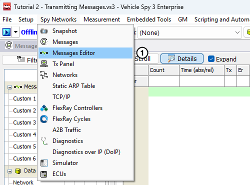
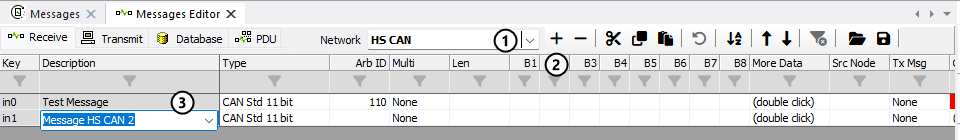
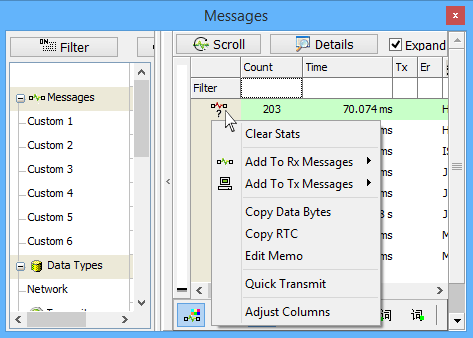

# Messages Editor: Overview

The Messages Editor is where you describe the messages Vehicle Spy works with. Receive messages tell Vehicle Spy what to look for in bus traffic, so the [Messages view](../messages-view/) can show them by name with their signals decoded. Transmit messages are the ones Vehicle Spy sends, either from the [Tx Panel](../transmit-panel/) or automatically at a set rate. Messages from [configured databases](../../main-menu-setup/network-databases.md) appear in a separate, read-only table, ready to copy into the Receive or Transmit tables. Each [message](./) has [properties](messages-editor-message-fields/) you can set, such as its arbitration ID, length or signals.

The Messages Editor has four tables: **Receive**, **Transmit**, **Database**, and **PDU**. The PDU table lists the PDUs that the network database defines; like the Database table, it cannot be edited. See [Messages Editor: Receive, Transmit, & Database Tables](messages-editor-receive-transmit-and-database-tables.md).

To access Messages Editor select **Spy Networks> Messages Editor** from the Main Menu (Figure 1: ).

In the Messages Editor, messages can be [added](add-and-delete-messages.md) from any [network](messages-editor-pick-a-network.md). Select the desired network from the dropdown (Figure 2:), click **+** (Figure 2:), and then type in the message description (Figure 2:).

When in the Messages view you can add messages to a table (Figure 3). Simply select any message, right click on its icon, and add it to the desired table (Rx for receiving or Tx for transmitting). Messages and signals can even be loaded from a [Database](../../main-menu-setup/network-databases.md).

The Messages Editor grid has many typical spreadsheet features including: [clipboard operations](messages-editor-cut-copy-and-paste.md), [undo](add-and-delete-messages.md), and [sorting](messages-editor-sort-and-arrange.md). These tools can be found in the toolbox along the top of Messages Editor view (Figure 4). Many of these features are also supported with a handy [right click menu](messages-editor-right-click-menu.md).

