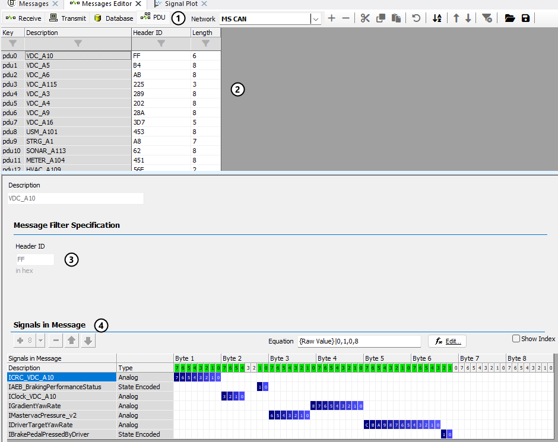

# Messages Editor: Receive, Transmit, & Database Tables

Use Messages Editor to edit, transmit, and receive messages. Press the **Receive**, **Transmit**, **Database**, and **PDU** buttons (Figure 1) to switch between the corresponding spreadsheets.

Database entries cannot be edited, but can be easily [copied](messages-editor-right-click-menu.md) into the Transmit or Receive tables.

## PDU Table

The **PDU** table (Figure 2:) lists the PDUs (Protocol Data Units) that the network database defines for the selected network. Each row (Figure 2:) shows the PDU's **Key**, its name in **Description**, its **Header ID** in hex, and its **Length** in bytes. If the selected network has no PDUs, the table is empty.

Select a PDU to see its **Header ID** (Figure 2:) and the layout of its signals (Figure 2:). Like Database entries, PDUs come from the database and cannot be edited here.

PDUs are transmitted from the PDUs tab of the Tx Panel; see [PDU Transmitters](../transmit-panel/pdu-transmit-object.md).

