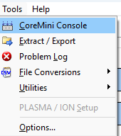

# Main Menu: Tools

The Vehicle Spy Tools main menu contains setup options, utilities, and hardware specific tools as shown in Figure 1. Refer to Table 1 for a brief description of each selection.

**Table 1: Vehicle Spy Tools Menu**

| Tools Menu Selection                                | Description                                                         |
| --------------------------------------------------- | ------------------------------------------------------------------- |
| [CoreMini Console](utilities-coremini-console/)     | Opens a configuration tool for loading CoreMini files to compatible hardware. |
| [Extract / Export](utilities-extract-export/)       | Extracts logger files and exports message and signal data.          |
| [Problem Log](tools-problem-log.md)                 | Displays Vehicle Spy software or hardware related problem logs.     |
| [File Conversions](utilities-file-conversions/) >   | Various file conversion utilities.                                  |
| [Utilities](tools-utilities/) >                     | Various file and hardware related utilities.                        |
| PLASMA / ION Setup                                  | Displays VNC window to access Android on neoVI PLASMA and neoVI ION |
| [Options](tools-options/)                           | Displays software options for Vehicle Spy.                          |
