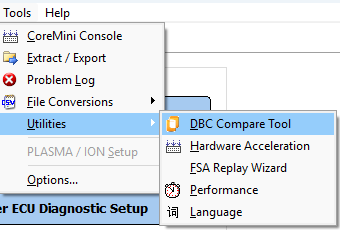

# Tools: Utilities

The Vehicle Spy [Tools](../) -> Utilities menu has database, scripting, performance and language tools as shown in Figure 1.  Refer to Table 1 for a brief description of each selection.

**Table 1: Vehicle Spy Utilities Menu**

| Utilities Menu Selection                                    | Description                                                                    |
| ----------------------------------------------------------- | ------------------------------------------------------------------------------ |
| DBC Compare Tool                                            | Opens a separate tool for comparing DBC database files.                        |
| [Hardware Acceleration](utilities-hardware-acceleration.md) | Allows certain types of function block scripts to run more quickly than usual. |
| FSA Replay Wizard                                           | Opens the FSA Replay Wizard. Load FSA databases before you use it.             |
| [Performance](tools-performance.md)                         | Displays numerous Vehicle Spy performance statistics.                          |
| [Language](tools-language.md)                               | Opens dialog to select a language.                                             |
