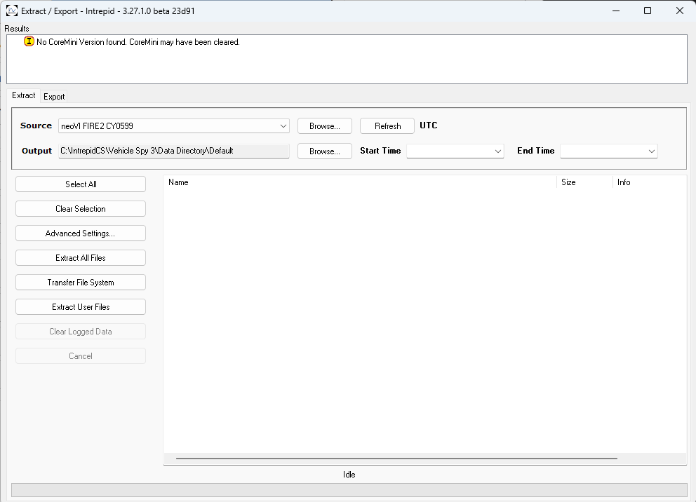
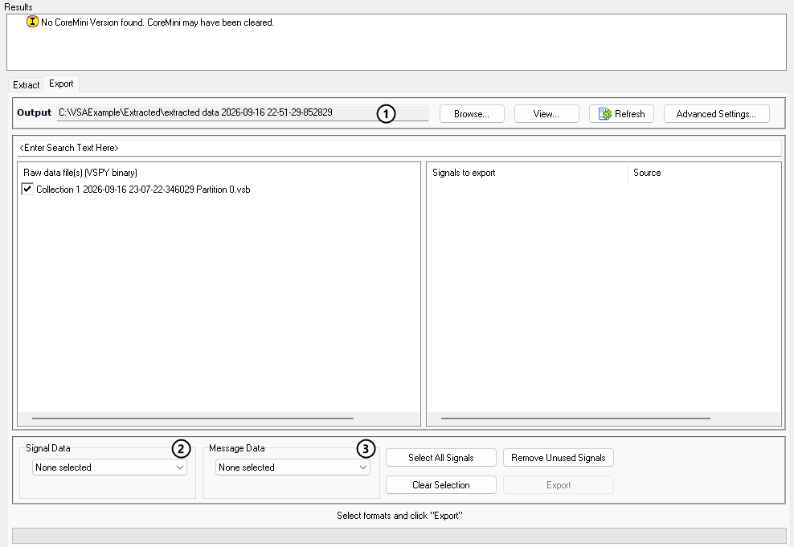

# Tools: Extract / Export

The [Tools](../) -> Extract / Export interface extracts data from [standalone logger](../../../application-notes/application-note-vehiclescape-standalone-logging/) SD cards and exports that data to various file formats. The **Results** area at the top of the window (Figure 1:) shows status messages. The two functions each have their own tab (Figure 1:).\
\
The [Extract Tab](utilities-extract-from-sd-card.md) (Figure 1) reads Vehicle Spy Archive (VSA) files from the SD card and converts them into Vehicle Spy Binary (VSB) files on the PC.

The Extract from SD Card page explains the [Source and Output](utilities-extract-from-sd-card.md#source-and-output) options, and how to extract only the data between a [Start Time and an End Time](utilities-extract-from-sd-card.md#filtering-by-start-time-and-end-time).

The [Export Tab](utilities-export-vsb-to-other-formats.md) (Figure 2) reads the extracted VSB files in its **Output** folder (Figure 2:). It converts them into the signal and message file formats you pick in **Signal Data** (Figure 2:) and **Message Data** (Figure 2:).

