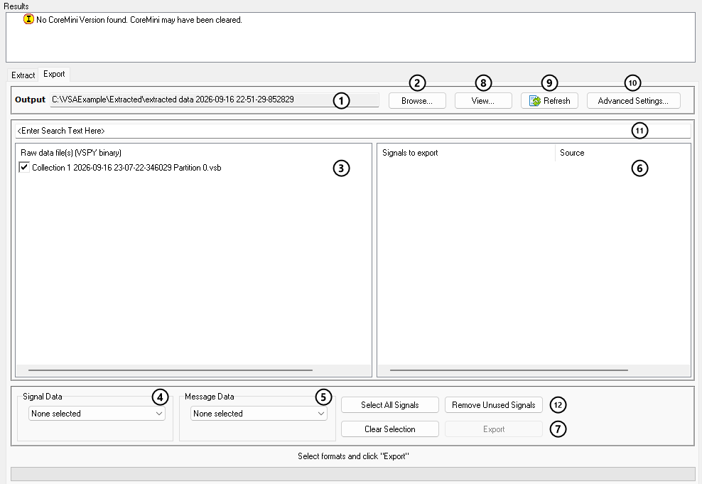

# Utilities: Export VSB to Other Formats

The second tab of the [Extract Export](./) interface (Figure 1) reads extracted VSB files and exports them into various other signal or message file formats.\
\
Follow these steps to export an extracted VSB file to another format:

1. [Extract](utilities-extract-from-sd-card.md) the VSB files from the SD card. When the extraction finishes, the Export tab opens with the extracted files listed.
2. Verify the **Output** folder (Figure 1:) is where the extracted VSB files are. To use another folder, click **Browse...** (Figure 1:).
3. Check the VSB files to export in the raw data file list (Figure 1:).
4. Pick one or more formats in **Signal Data** (Figure 1:) or **Message Data** (Figure 1:).
5. If a Signal Data format is used, check which signals to export in the signal list (Figure 1:).
6. Click the **Export** button (Figure 1:) to make the new files. They are saved next to each VSB file with the same name, and Windows Explorer opens the folder when the export is finished.
7. Watch the status under the Export button.

**Signal Data** offers Vehicle Spy Log File (.csv), MAT and MDF. **Message Data** offers Vehicle Spy BusCapture (.csv), Vector Log (.asc), BLF, PCAP and PCAPNG.

The **View...** button (Figure 1:) opens the output folder in Windows Explorer, and **Refresh** (Figure 1:) reloads the list of VSB files in it. **Advanced Settings...** (Figure 1:) opens the [Advanced Extractor Options](utilities-extract-from-sd-card.md#advanced-extractor-options), where the Export tab controls how files are exported.\
\
Type in the search box (Figure 1:) to filter the signal list by signal, message or network name. **Select All Signals** and **Clear Selection** check or uncheck every signal in the list, and **Remove Unused Signals** keeps only the signals found in the checked VSB files (Figure 1:).\
\
In the raw data VSB file list area there is a convenient right click menu to check or uncheck files, and to combine the checked VSB files into one file with **Combine checked files**.\
\
The **Force Rate** value on the Export tab of the [Advanced Extractor Options](utilities-extract-from-sd-card.md#export-tab) forces a periodic rate on all signal timestamps in the exported file. A value of -1 means the signal timestamps will be left untouched. That is, the signals in the exported file will use the timestamps from the VSB file. When a rate is set, it is shown in the Signal Data area.
