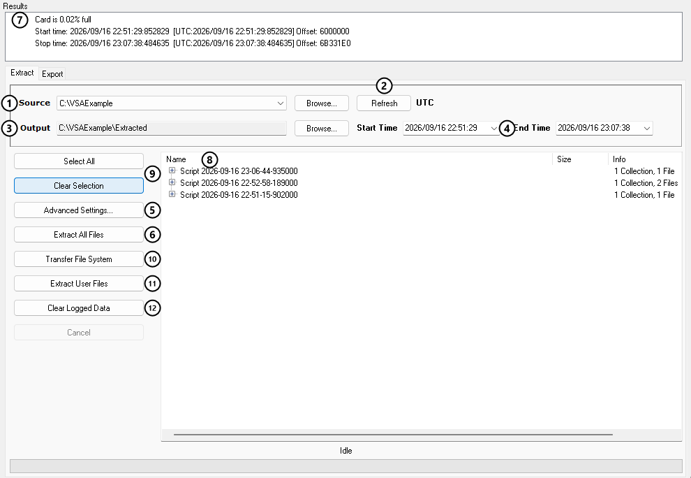
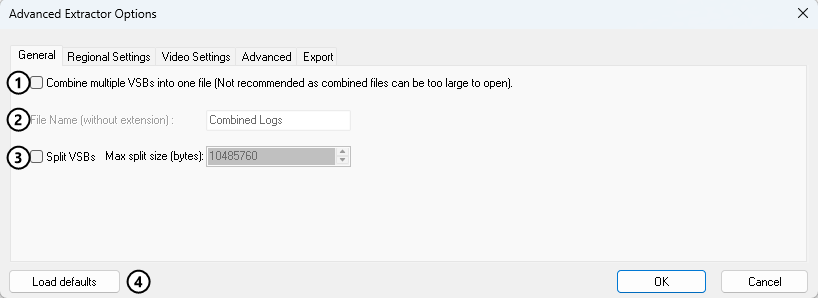
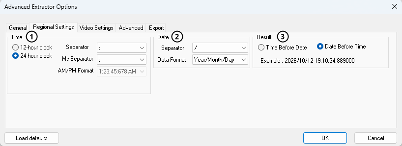
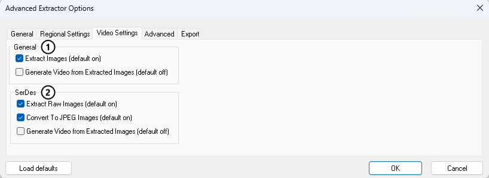
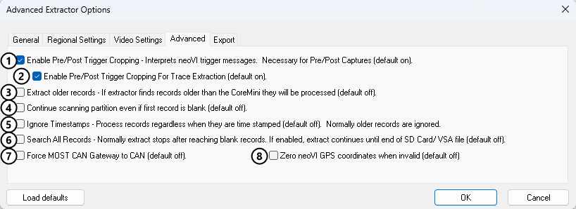
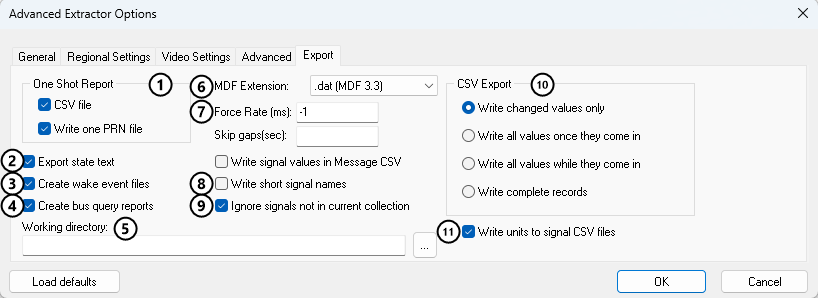

# Utilities: Extract from SD Card

The first tab of the [Extract / Export](./) interface (Figure 1) extracts data from [standalone logger](../../../application-notes/application-note-vehiclescape-standalone-logging/) SD cards.\
\
Properly formatted SD cards are named "LOGGER" and have Vehicle Spy Archive (VSA) files on them that must be converted to Vehicle Spy Binary (VSB) files to be useful. The VSB files can then be used directly in Vehicle Spy or [exported](utilities-export-vsb-to-other-formats.md) to other file formats.\
\
Follow these steps to pull data from an SD card and put VSB files on a PC:

1. Connect the SD card to the PC.
2. In **Source** (Figure 1:), select the "LOGGER" SD card. If it is not listed, click **Refresh** (Figure 1:). To extract from a folder that holds a copy of the card's VSA files, click the **Browse...** button next to **Source** and select that folder.
3. In **Output** (Figure 1:), select where to put extracted VSB files on the PC.
4. If needed, narrow the **Start Time** and **End Time** range (Figure 1:) or change the **Advanced Settings** (Figure 1:).
5. Click the **Extract All Files** button (Figure 1:) to make the VSB files. Vehicle Spy creates a folder inside the output folder, named "extracted data" followed by the date and time the logged data starts,, and opens it in Windows Explorer when it is finished.
6. Watch the **Results** area (Figure 1:) for status updates.

The file list (Figure 1:) shows the scripts on the card. Expand a script to see its collections and files. To extract only some files, select them: the **Extract All Files** button changes to **Extract Selected Files** and shows how many are selected. **Select All** and **Clear Selection** (Figure 1:) select or clear every item in the list. Files outside the **Start Time** and **End Time** range are greyed out and cannot be selected.

The time zone of the start and end times and of the extracted file names is shown next to **Refresh**. To change it, use **Message Display Time Zone** under [Tools -> Options -> Regional Settings](../tools-options/options-regional-settings.md) in Vehicle Spy.

The **Transfer File System** button (Figure 1:) copies the raw VSA file from the card to a new folder on the PC without converting it. The **Extract User Files** button (Figure 1:) extracts only the user files that the CoreMini script stored on the card.

The **Clear Logged Data** button (Figure 1:) clears the logged data on the SD card while leaving the CoreMini script intact. A yes/no dialog confirms the choice. After that, extractions skip the data that was recorded before the card was cleared, unless **Ignore Timestamps** is selected on the [Advanced tab](#advanced-tab).

### Advanced Extractor Options

The **Advanced Settings** button (Figure 1:) opens the Advanced Extractor Options dialog. Its five tabs are shown in Figures 2 to 6. The **Load defaults** button (Figure 2:) returns the settings on every tab to their defaults. Click **OK** to save your changes, or **Cancel** to discard them.

### General tab:

Extracted files can be combined into one VSB file or split into limited size VSB files using the settings here (Figure 2).

* **Combine multiple VSBs into one file** (Figure 2:) (disabled by default) - When you extract all files, the extracted VSB files are merged into one file. This is not recommended, because a combined file can be too large to open.
* **File Name (without extension)** (Figure 2:) ("Combined Logs" by default) - The name of the combined file. It can be changed only when **Combine multiple VSBs into one file** is selected.
* **Split VSBs** (Figure 2:) (disabled by default) - Starts a new VSB file when a file grows larger than **Max split size (bytes)** (10485760 bytes, which is 10 MB, by default).

### Regional Settings tab:

This allows the control of how the date and time will appear (Figure 3). They are used in the extracted folder and file names, the file list, the start and end times, and the results. Changes to these settings also affect those found on the [Tools -> Options -> Regional Settings](../tools-options/options-regional-settings.md) tab.

* **Time** (Figure 3:) - A 12-hour or 24-hour clock (24-hour by default), the separator between hours, minutes and seconds, and the separator before the milliseconds. For a 12-hour clock, **AM/PM Format** sets whether AM or PM comes before or after the time.
* **Date** (Figure 3:) - The separator between the parts of the date ("/" by default) and their order (Year/Month/Day by default).
* **Result** (Figure 3:) - Whether the date comes before or after the time (Date Before Time by default), with an example.

### Video Settings tab:

This allows modification of how video is extracted and saved if cameras are being used to log video alongside other data in the particular setup (Figure 4).

* **General** (Figure 4:) - For network cameras. **Extract Images** (enabled by default) saves the camera images. **Generate Video from Extracted Images** (disabled by default) also makes a video from those images.
* **SerDes** (Figure 4:) - For SerDes cameras. **Extract Raw Images** (enabled by default) saves the raw camera frames, and **Convert To JPEG Images** (enabled by default) converts them to JPEG images. **Generate Video from Extracted Images** (disabled by default) also makes a video from them.

### Advanced tab:

Options in the Advanced tab (Figure 5) are used for trouble shooting.  In most cases they will not be needed to be changed.

* Enable Pre/Post Trigger Cropping (Figure 5:) (enabled by default) - When this option is enabled, data from standalone captures that are configured as Pre/Post collections are trimmed to include only the data that meets the time or message count it was configured for.  If this option is disabled, extra data before and after the trigger condition could be extracted.
* Enable Pre/Post Trigger Cropping For Trace Extraction (Figure 5:) (enabled by default) - Applies the same cropping when trace data is extracted. It is available only when the option above is enabled.
* Extract older records (Figure 5:) (disabled by default) - When data is extracted from the card, the timestamps are looked at to ensure the newest data is extracted.  This option is available to help pull data with older time stamps.
* Continue scanning partition even if first record is blank (Figure 5:) (disabled by default) - This option is another trouble shooting option.  When this is enabled, the entire card is scanned to pull any data it find on the card.  Using this option takes much longer to scan and in most cases it is not needed.
* Ignore Timestamps (Figure 5:) (disabled by default) - If enabled, this option will pull all data regardless of the time stamp on the message and when the CoreMini script was loaded.  When disabled, only messages newer than when the CoreMini was loaded, or than the last **Clear Logged Data**, are extracted.
* Search All Records (Figure 5:) (disabled by default) - Turning this option on will search through the card for all possible records.  When disabled, it will stop when a set number of blank entries are received.  For normal operation, the blank entries serve as an end of collection.
* Force MOST CAN Gateway to CAN (Figure 5:) (disabled by default) - For use with older setups.  If enabled it will force the MOST to CAN gateway to just CAN.
* Zero neoVI GPS Coordinates When Invalid (Figure 5:) (disabled by default) - When enabled, Invalid GPS data from the hardware is set to 0.

### Export tab:

Configurations for how data is exported and converted are made on the Export tab (Figure 6) of the Advanced Extractor Options.

* One Shot Report (Figure 6:) (Both checked by default) - This option gives the choice of using a \*.CSV, \*.PRN, or both for output of one shot collections.
* Export State Text (Figure 6:) (Enabled by default) - The way state encoded signals are represented are controlled through this option.  When checked, the state name is recorded rather than the state index.  This option only affects CSV type exports.
* Create Wake Events Files (Figure 6:) (Enabled by default) - When checked, Wake Event text files will be generated indicating when the hardware went to sleep during the collection time span.
* Create Bus Query Reports (Figure 6:) (Enabled by default) - Enabled, Bus query reports are generated when bus query collections are configured.
* Working directory (Figure 6:) (empty by default) - The folder for the temporary files that Vehicle Spy creates while it exports signals. When it is empty, Vehicle Spy uses the folder of the VSB file.
* MDF Extension (Figure 6:) (.dat is default) - The MDF file type has different data type outputs.  The Extension gives the option to select the file extension for MDF outputs: .log, .dat or .mdf for MDF 3.3, or .mf4 for MDF 4.0.
* Force Rate (ms) (Figure 6:) (-1 by default) - Forces a periodic rate on all signal timestamps in signal export files. A value of -1 means the signal timestamps are left untouched, so the exported signals use the timestamps from the VSB file.
* Write short signal names (Figure 6:) (Disabled by default) - When enabled, the signals are saved with their shorter names pulled from the database if applicable.
* Ignore Signals not in Current Collection (Figure 6:) (Enabled by default) - This option gives the choice to only exporting signals that were originally defined for that collection.
* CSV Export (Figure 6:) ("Write changed values only" by default) - The signal based CSV can be saved in a few different formats.  Different options will require different amounts of space to save.
  * Write Changed Values only - Only creates an entry for that signal when the data changes
  * Write All Values Once They Come In - Values are only added once the message is received.
  * Write All Values While They Come In - Values will only be during the duration that the message is active during the collection.
  * Write Complete Records - Uses the most space but has values entered in for every cell.
* Write units to signal CSV files (Figure 6:) - Adds the unit of each signal to its column heading in signal CSV files.

