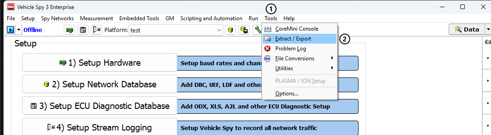
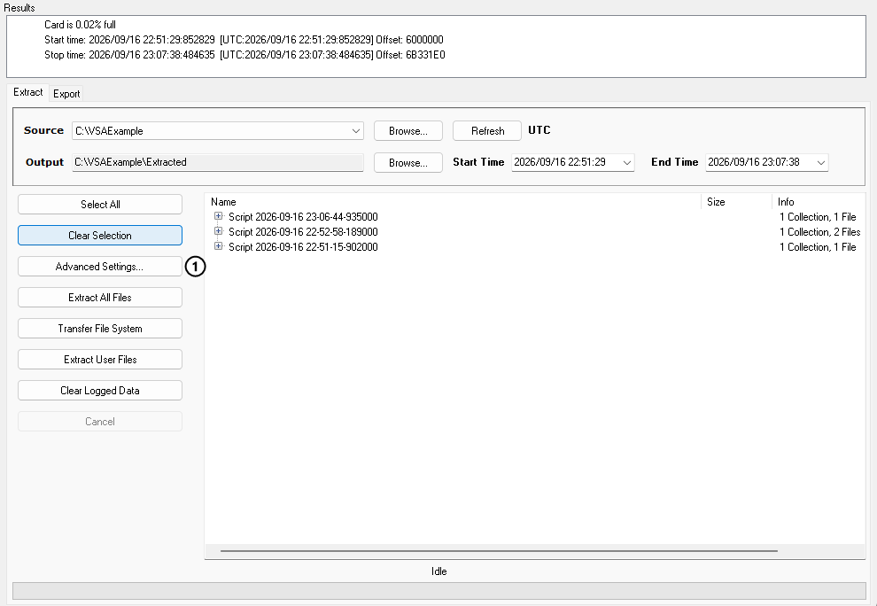
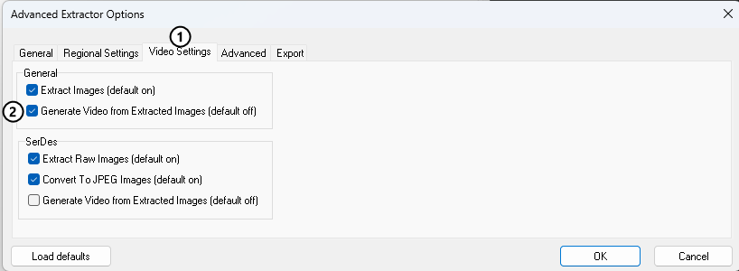
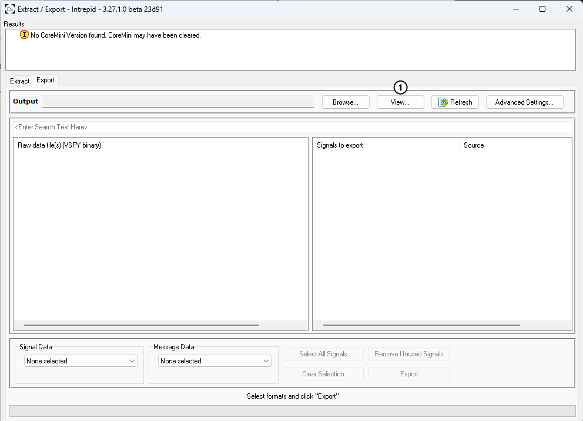
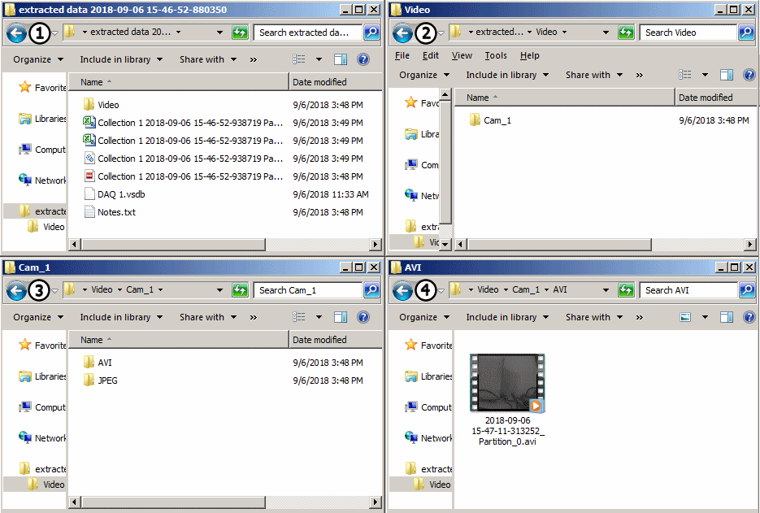

# Tutorial: Standalone Video Logging - Part 3 - Extracting the Video

### 1. Open the Extract/Export Tool

To open the Extract/Export tool, click Tools (Figure 1) -> Extract/Export (Figure 1).

### 2. Set Up 'Extract' Settings

Under the Extract tab, click the 'Advanced Settings' button (Figure 2 ).

In the 'Advanced Extractor Options' window, click the 'Video Settings' tab (Figure 3 ). In the General group, make sure that the 'Generate Video from Extracted Images' box (Figure 3 ) is checked. Click 'OK' when finished.

### 3. Extract and export data

Extract and export the data according to the needs of the project. For information on how to do this, refer to the [Standalone Logging tutorial](../tutorial-simple-standalone-logging/). Finally, on the Export tab, click the 'View...' button next to 'Output' (Figure 4 ) and open the folder containing the extracted data.

In the Extracted Data folder, click on Video, then on Cam\_X (X will be the number you assigned to 192.168.2.X), then on Video. This folder holds the final video (.mp4) made from the logged images. The JPEG folder next to it holds the individual images. From here, the video can be edited, saved, or whatever is required for the project.

